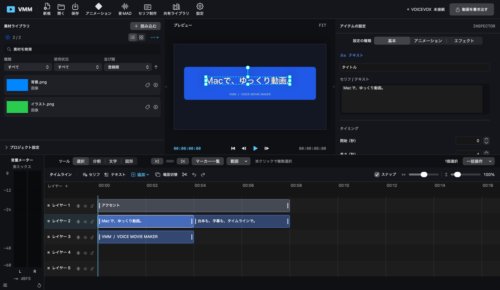

# VMM — Voice Movie Maker

VMMは、Macで音声合成を使った解説動画や音MADを制作するための動画編集アプリです。素材ライブラリ、プレビュー、レイヤー式タイムライン、字幕・アニメーション編集、動画書き出しを備えています。現在はβ版です。



*編集画面の例。画像は説明用のサンプルです。*

## 動作環境

- macOS 13以降。配布するアプリの対応CPUは配布物をご確認ください。
- 音声合成には、別途起動した対応音声エンジンが必要です。対応エンジン、設定と検証範囲は[音声エンジンの案内](docs/SPEECH-ENGINES.md)を参照してください。

## はじめ方

上の画面例では、左が素材ライブラリ、中央がプレビュー、右が選択したアイテムの設定、下がタイムラインです。タイムラインは時間に沿って素材を並べる場所です。

1. **文字を置く**：下のタイムラインでレイヤーと時刻を選び、「テキスト」を押します。追加されたアイテムを選び、右側の入力欄に文字を入力します。素材がなくても試せます。空の作品から始めたい場合は、左上の「新規」を押します。
2. **素材を置く**：左上の「読み込む」から画像・動画・音声を選ぶか、Finderから素材ライブラリへドラッグします。登録した素材の「＋」を押すと、選択中のレイヤーの再生位置に配置されます。Finderからタイムラインへ直接ドラッグすることもできます。[対応形式](docs/MEDIA-FORMATS.md)
3. **位置と長さを調整する**：タイムラインのアイテムをドラッグして移動し、左右の端をドラッグして長さを変えます。アイテムを選ぶと、右の設定やプレビューで位置・大きさ・文字の装飾を変更できます。通常はレイヤー番号が大きいほど前面です。3Dカメラ有効時は奥行き順になります。
4. **セリフを読ませる**：別途VOICEVOXなどを起動し、VMMの「設定」→「アプリの設定…」→「音声エンジン」で接続します。タイムラインの「セリフ」を追加して選び、右側で本文と話者を設定して「音声を生成」を押します。[音声エンジンの詳しい手順](docs/SPEECH-ENGINES.md)
5. **再生・保存・書き出し**：プレビューの再生ボタンで確認し、`⌘S`でプロジェクトを保存します。初回は保存先と名前を選びます。右上の「動画を書き出す」で設定を開き、画面内の「動画を書き出す」を押して保存先を選びます。[書き出し設定](docs/EXPORT-TEMPLATES.md)

[機能一覧とマニュアル](docs/README.md) ・ [制作機能と画面の使い分け](docs/WORKFLOW-GUIDE.md)

## 主な機能

- 画像・動画・音声・テキスト・セリフの配置、字幕、キャラクターごとの字幕設定
- PSD立ち絵のレイヤー・表情切り替え、口パク・目パチ。[PSD対応範囲](docs/PSD-COMPATIBILITY.md)
- キーフレーム、グラフ、カーブ、移動パス、エフェクト、マスク、モーションブラー、プリコンポジション。[アニメーション編集](docs/ANIMATION-WORKSPACE.md)・[高度なアニメーション](docs/ADVANCED-ANIMATION.md)・[プリコンポジション](docs/PRECOMPOSITIONS.md)
- 動画・音声の逆再生と速度変化、平面素材を透視投影する2.5Dカメラ。[操作方法と制限](docs/ADVANCED-EDITING.md#詳細な変形)
- 拍グリッドや音声のピッチ・タイミング編集に使える[音MADモード](docs/AUDIO-MAD-MODE.md)。
- 日本語・英語の表示、パネルの分離、ショートカット、書き出しテンプレート、書き出しキュー
- AIや外部ツールから操作する[MCP接続](docs/CONTROL-MCP.md)。通常は無効で、認証付きのローカル接続を使用します。

VMMはYMM4やAviUtlの完全互換ではありません。`.ymmp`の読み込み、Windows向けプラグインやLuaスクリプトの実行には対応していません。PSDToolKitについても[対応範囲](docs/PSD-COMPATIBILITY.md)をご確認ください。

## ソースコードからビルドする

Macのターミナルで、ソースコードからVMMアプリを作成できます。操作中のVMMがある場合は、先にプロジェクトを保存して終了してください。

### 1. 開発ツールを用意する

macOS 13以降のMacと、Swift 5.9以降を含むXcodeまたはXcode Command Line Toolsが必要です。外部のSwiftパッケージは不要です。開発ツールが未導入の場合は、「アプリケーション」→「ユーティリティ」→「ターミナル」を開き、次を実行して表示される手順に従ってください。

```sh
xcode-select --install
```

インストール済みか確認するには `swift --version` と `git --version` を実行します。利用許諾への同意などを求められた場合は、画面の案内に従ってください。検証環境はAppleシリコンのMacとXcode 27.2です。Intel Macでのビルドは未確認です。

### 2. ソースコードを取得する

ターミナルで、保存したいフォルダへ移動してから次を実行します。リポジトリのアクセス権が必要な場合は、GitHubの認証が求められます。

```sh
git clone https://github.com/zjs49gctg5-cyber/VMM.git
cd VMM
```

ZIPでソースコードを取得した場合は、展開したフォルダをターミナルにドラッグしてパスを入力し、その前に `cd ` を付けてReturnを押します。以下のコマンドは、そのフォルダの中で実行してください。

### 3. アプリをビルドして起動する

```sh
zsh scripts/build-latest.sh
open dist/VMM-latest.app
```

ビルドには数分かかることがあります。完成したアプリは `dist/VMM-latest.app` にあります。Finderで開くには `open dist` を実行してください。再ビルドする場合も、編集中のVMMを保存・終了してから同じコマンドを実行します。スクリプトは一時領域でビルドと署名検証を済ませてから、既存の `VMM-latest.app` を置き換えます。作品や素材、ほかの配布ファイルは変更しません。

生成されるアプリはアドホック署名され、Developer ID署名・公証はされません。macOSのセキュリティ機能によって起動を拒否される場合は、[配布時の確認と署名・公証の手順](docs/SIGNING-NOTARIZATION.md)を参照してください。

### テストを実行する場合

ソースコードのフォルダで次を実行します。最初の実行には時間がかかることがあります。

```sh
export CLANG_MODULE_CACHE_PATH="$PWD/.build/clang-cache"
export SWIFTPM_MODULECACHE_OVERRIDE="$PWD/.build/module-cache"
swift test --disable-sandbox --cache-path "$PWD/.build/cache"
```

## 外部操作・拡張

[MCP操作スキル](skills/vmm-control/SKILL.md)と[AGENTS.md雛形](automation/AGENTS.md.template)を用意しています。[AIクライアント別のMCP・スキル設定](docs/AI-CLIENT-SETUP.md)も参照してください。[JSONアニメーション定義](docs/DATA-EXTENSIONS.md)と[JavaScriptCoreカスタムアニメーション](docs/JAVASCRIPT-ANIMATIONS.md)も利用できます。公開HTTP操作APIはありません。

## ライセンス

このリポジトリのVMMは[MITライセンス](LICENSE)で公開します。利用・改変・再配布の際は著作権表示とライセンス本文を保持してください。外部の音声合成エンジン、モデル、素材やmacOSのフレームワークには、それぞれの利用条件が適用されます。

## 免責事項

VMMはβ版です。初回公開前の開発版で作成したプロジェクトとの互換性は保証しません。ソフトウェアは無保証で提供されます。免責事項を含む利用条件は、[MITライセンス本文](LICENSE)をご確認ください。重要なプロジェクトや素材はバックアップを保管してください。

制作・公開する動画の素材、音声合成エンジンやモデルについては、それぞれの権利と利用条件を確認してください。
