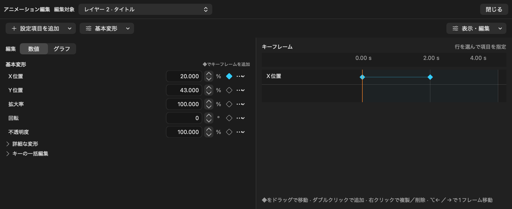

# アニメーション編集

ツールバーの「アニメーション」、またはアイテム設定の「アニメーション」から「アニメーションを編集」を選ぶと、タイムラインとプレビューを残したまま編集領域を開ける。ワークスペース設定の「レイアウト」からアニメーションパネルを独立ウィンドウにすることもできる。編集対象はタイムラインの選択に追従し、上部の「編集対象」でも切り替えられる。編集画面を開くだけでは設定を追加・変更しない。

*左で数値を編集し、右でキーフレームを操作します。キーフレームは、ある時刻の値を記録する点です。*

### 例：文字を横に移動させる

1. タイムラインでテキストを選び、上部の「アニメーション」を押します。
2. 「基本変形」でX位置の右にある◆を押します。初めてキー化すると、開始・終了にもキーが用意されます。
3. 右側のキー一覧で開始時刻の◆を選び、左のX位置に開始時の値を入力します。
4. 終了時刻の◆を選び、X位置に終了時の値を入力します。キーは左右にドラッグして時刻を調整できます。
5. メイン画面のプレビューで再生し、移動を確認します。

## 設定項目を追加する

上部の **「設定項目を追加」** では「変形」「見た目」「文字・立ち絵」「動きのプリセット」「高度な操作」に分類して表示する。ここから基本変形のプロパティ、モーションブラー、残像、映像エフェクト、移動パス、文字、図形・マスク、表情、登場・退場、反復、音声フェード、音声連動、追跡、カスタムアニメーションを選ぶ。対象に使える項目だけを表示する。現在の項目名が表示されたメニューから、追加済みの設定を選んで編集する。音声解析や移動パス等は、その設定欄で作成・解析したときにモデルを追加する。

新しい基本変形の項目には現在の再生位置にキーを作り、元の値から編集できるようにする。ブラー／残像は追加した設定のキーを作る。残像だけを追加した場合はシャッター0°でブラーを無効にする。設定の解除や項目削除はUndoで戻せる。

## キーフレームを常に表示する

どの設定を選んでも共通のキーフレーム一覧を表示する。メイン画面と独立ウィンドウのどちらでも設定欄の右に表示する。基本変形、ブラー／残像、エフェクトの強さ、移動パスの点、図形／マスクの形、線の開始／終了範囲、立ち絵の表情切り替えを同じ時間目盛りに並べる。設定していない変形の空行は表示しない。

行をクリックして編集項目を指定する。◆をクリックすると該当の設定へ切り替わり、設定欄で **値・時刻・次のキーまでの補間** を編集できる。数値プロパティにはカーブ編集もある。図形・マスクの行は対応するマスクを選び、移動パスの行では選択した点の座標・ハンドルを表示する。表情は次のキーまで保持する。

- 空白をダブルクリック、または「現在位置にキーを追加」で追加する。
- ◆を左右へドラッグして時刻を変更する。
- 右クリックで追加・複製・削除。Deleteでも選択キーを削除できる。
- ⌥←／→で選択キーを1フレーム移動。通常の←／→は再生位置を移動する。
- 同じ行・同じ時刻に重なる移動は変更せず拒否する。移動パスは最低2点、形は最低1キーを維持する。

キー一覧上部の「時間軸の拡大」と「表示位置」で、長いアイテムの一部を拡大して確認できる。「時間軸を全体表示」で元に戻る。

共通タイムラインでは開始／終了キーも編集できる。「全キーを表示」はトリム前や分割前の範囲外のキーを含めて表示する。表示される時刻は現在のアイテムの開始からの秒数なので、範囲外のキーには負の時刻も表示する。キーを選んでもプレビューの再生位置は現在のアイテムの範囲内に保つ。背景の薄い色は現在のアイテム範囲。範囲外のキーの値を修正すると元の補間にも反映される。

キーのない数値項目は「固定値」と表示する。登場・退場、反復、文字単位の動作、音声フェード、場面切替は開始・継続時間の設定で動くので、◆と区別した帯で表示する。それらの行を選ぶと時間指定の設定欄を開く。無効な変形・エフェクト・マスクは無効と表示し、既存のキーを保持する。

メイン画面では領域の高さと設定欄の幅を仕切りで調整できる。独立ウィンドウでも設定欄の幅を調整できる。設定欄とキー一覧は別々に縦スクロールし、時間目盛りはキー一覧をスクロールしても固定する。

## モーションブラー・残像の中間点

「設定項目を追加」からブラー／残像を追加する。**シャッター角度・描画サンプル数・残像の数・長さ・不透明度** にキーを設定できる。

右側の◆ボタンでその項目をキー化する。キー化後の設定欄の数値変更は現在時刻へ記録する。下の◆を選んだときは「選択したキーの値」「キーの時刻」で選択したキーそのものを編集する。「現在位置を編集」でキー選択を外して現在時刻を編集できる。サンプル数と残像数は描画時に整数へ丸める。数の切り替えには「瞬間切り替え」が適している。

例えば残像の不透明度を開始0%、1秒40%、終了0%にすると、途中だけ残像が現れる。シャッター0°→180°のキーでブラーを徐々に強くすることもできる。停止中と書き出しは指定サンプル数、再生中は最大4サンプルで描画する。

## プレビュー・再生・グラフ

プレビューで移動・回転・伸縮できる。移動パスへ中間点を追加するときはベジェ曲線を分割し、直線・曲線の形を維持する（非線形イージングの区間は追加によって時間配分が変わることがある）。

「基本変形」の「数値／グラフ」をグラフへ切り替えると複数プロパティの値／速度を確認できる。グラフを開いても共通のキー一覧を表示する。始点・中間点・終点は左右で時刻、上下で値をドラッグ編集できる。速度表示は時刻のみ。重なった点は「操作対象」で選択する。任意の数値キーのカーブ編集でカスタムイージングを使える。

再生はメイン画面のプレビュー、または独立したプレビーパネルで操作する。アニメーションパネル自体には再生ボタンや区間ループの操作はない。

独立したアニメーションパネルの最小サイズは700×300pt。数値欄の上下キーは表示値を1ずつ増減し、%も1ポイント単位。小数点以下3桁の%入力を維持する。

新しいキーも既存のClip.animation.tracksに保存する。新しいプロジェクトの必須フィールドは追加していない。既存の形・表情・エフェクト・パスの保存データを共通タイムラインから直接編集する。

## 基本変形のまとめ編集

位置X/Y・拡大率・回転・不透明度をひとつの基本変形欄にまとめた。音声を持つアイテムは音量も表示する。固定値はそのまま編集でき、アニメーションが有効な項目は再生位置にキーを作成・更新する。右側の◆を選択した項目は、そのキーの値を直接編集する。

各数値の右にある◆で現在位置へキーを追加する。有効／無効、アニメーションの削除は「…」へまとめた。横・縦倍率、傾斜、範囲サイズは「詳細な変形」を開く。時刻・補間は選択したキーだけ表示し、値欄の重複をなくした。削除・複製は共通キー一覧の右クリックを使う。

数値とグラフは設定欄の切り替えで編集する。共通キーフレームは常に表示する。選択した数値項目はグラフの表示対象へ追加する。グラフの表示項目はメニューで選択する。トリム前後を含む全キー表示は上部「表示・編集」で切り替える。

## 場面切り替えの範囲

場面切り替えアイテムよりタイムライン上で下にあるレイヤーが対象です。同じレイヤーと上にあるレイヤーのアイテムは切り替え処理の対象になりません。各レイヤーの通常の重ね順は変わらないため、下のレイヤーの移動や表示によって上のアイテムが隠れる場合があります。音声は切り替え処理の対象外です。
