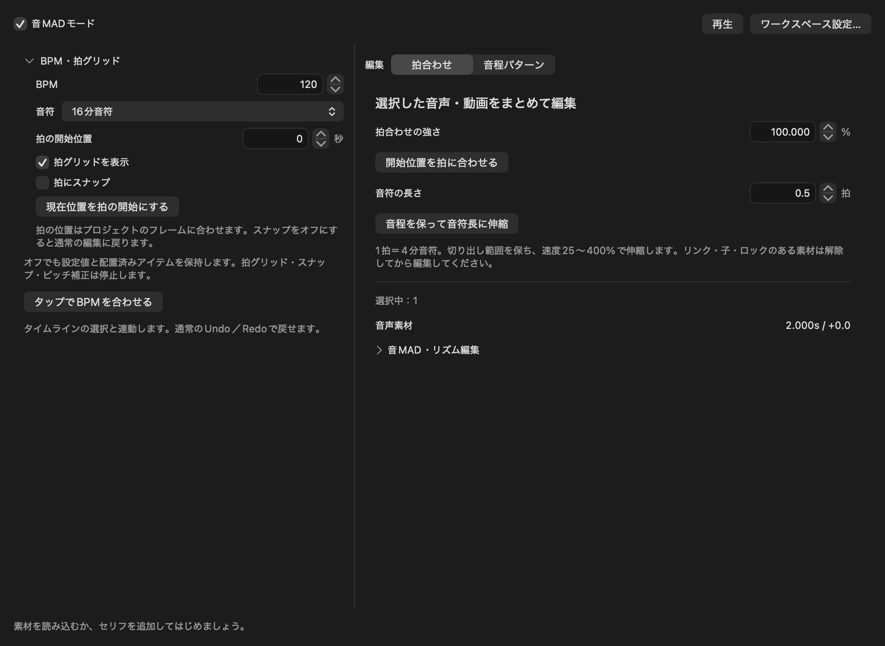

# 音MADモード

ツールバー「音MAD」または「ファイル → 音MADモード…」で専用のリサイズ可能なウィンドウを開きます。上部の有効／無効はプロジェクト単位です。通常のタイムライン選択と連動し、既存の編集パネルを置き換えません。

WAVなどの音声素材は、Finderから素材ライブラリやタイムラインへ読み込んで配置できます。

*音MADモードの例。左で拍グリッド、右で選択素材の拍合わせを設定します。*

1. タイムラインに音声や動画を配置し、対象を選びます。
2. ツールバーの「音MAD」を開き、上部の「音MADモード」を有効にします。
3. 左側でBPMと音符間隔を設定します。右側の「拍合わせ」では開始位置や長さを調整できます。
4. 「音程パターン」では、選択した素材を使った繰り返しを現在位置に配置できます。変更はUndoで戻せます。

## 拍合わせ

- BPM（30〜300）、音符間隔、開始位置、拍スナップを左側にまとめました。タップテンポは直近8回の平均間隔を使用し、2秒以上空くと測り直します。
- 選択音声・動画・生成済みセリフの開始位置をまとめて拍に合わせます。強さ0〜100%で調整でき、0%は変更しません。
- 「音程を保って音符長に伸縮」は、現在の切り出し範囲を保持して速度を変更します。1拍＝4分音符、0.125〜64拍、速度25〜400%。範囲外では変更せず理由を表示します。
- 一括操作は1回のUndo。ロック・リンク・子を持つ素材、未生成セリフが選択に含まれる場合は全体を拒否します。

## 歌詞・MADテキスト演出

1. タイムラインで配置先レイヤーを選び、音MADモードの「歌詞演出を作成」を開きます。
2. 歌詞を1行ずつ入力し、開始位置と1行の長さを設定します。長さは秒または現在のBPMの拍数で指定できます。
3. 文字の演出を選び、「歌詞を時間に配置」で候補を作ります。各行の文章と開始・終了フレームは個別に調整できます。行を選択してプレビューを更新すると、その行の開始後のフレームを縮小表示します。
4. 「タイムラインに配置」で通常のテキストアイテムとして追加します。配置後も文字・時間・アニメーションを個別に編集できます。1回のUndoで一括して取り消せます。

時刻は音声から推測しないため、映像や音声を確認して調整してください。「歌詞を時間に配置」を押し直すと、候補の個別調整は入力欄の内容で置き換わります。配置先のロックやFPS変更は適用前に検出します。

## 音程パターン

素材を選び、半音差を空白区切りで入力します。0で原音、12で1オクターブ上、`-`は休符です。ステップボタンを選んで数値と休符を編集でき、反復・上昇・跳躍の例も用意しています。

現在位置から拍グリッドの間隔でコピーを追加し、元の素材は保持します。ゲートは音符が鳴る長さの割合（5〜100%）。音程−24〜24半音、最大512ステップ。各区間の開始と終端を個別にフレームへ丸め、BPMによる累積誤差を防ぎます。微小フェードを付けて境界のクリックを抑えます。1フレーム未満や伸縮範囲外の音符は配置前に拒否します。

## BPM・MIDIに合わせたモーション

1. タイムラインで画像・文字などの映像アイテムを選び、音MADモードの「音楽モーション」を開きます。
2. 「拡大」または「上下バウンド」と動きの強さを設定します。BPMでは、プロジェクトの拍の開始位置を基準に、現在位置以降の4分音符に合わせます。
3. MIDIを使う場合は「MIDIを読み込む」からファイルを選び、必要に応じてチャンネルを指定します。MIDIの先頭は現在の再生位置に合わせられ、音符の開始と強さ（ベロシティ）に同期します。テンポ変更にも対応します。
4. 「キーフレームを作成」を押します。アニメーション編集画面で生成したキーを変更でき、1回のUndoで取り消せます。対象項目にすでにキーがある場合は上書きしません。

SMF形式0・1のPPQN時間形式、2 MiB・50,000イベント以内に対応します。形式2・SMPTE時間・破損したMIDIは読み込めません。同じフレームの音符は強さが大きいものにまとめ、対象アイテム内に最大249拍／音符を配置できます。ファイルは自動監視せず、生成したキーフレームがプロジェクトに保存されます。移動パスが有効なアイテムでは上下バウンドを選べません。

## MCP

- `rhythm.quantize`: `clipIDs`、`strength`（0〜1、既定1）。
- `rhythm.fit`: `clipIDs`、`beats`（4分音符単位）。
- `rhythm.pattern`: `clipID`、`pattern`、任意の`start`（秒）、`gate`（既定0.9）。新規clipIDsを返す。

すべて`rhythm.update`で`enabled=true`にしてから実行します。拍編集は既存の再生・出力用AVAudioUnitTimePitchを使用し、別の音声実装は追加していません。
