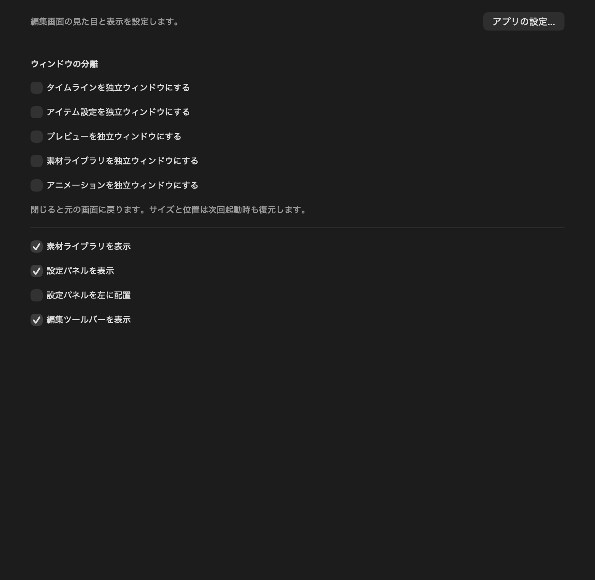

# 編集パネルの独立ウィンドウ

VMMメニュー → ワークスペース設定… → レイアウト → ウィンドウの分離で、以下を個別に切り替えられます。

- タイムライン（編集ツールバーを含む）
- アイテム設定
- プレビュー（メインのツールバーを含む）
- 素材ライブラリ（プロジェクト設定を含む）
- アニメーション（共通のキーフレーム編集パネル）

*ワークスペース設定の「レイアウト」の内容。必要なパネルだけを分離できます。*

分離したパネルはメイン画面から取り除かれ、サイズ変更・移動・最小化できる通常のmacOSウィンドウになります。サイズと位置、分離の設定は次回起動にも引き継ぎます。macOSのウィンドウメニューから各ウィンドウを手前に出せます。

メインウィンドウを閉じても他のウィンドウが開いている間は編集を続けられます。ウィンドウメニューの「メインウィンドウを表示」で再表示できます。未保存の変更も保持します。

独立ウィンドウを閉じるか分離のチェックを外すと、パネルはメイン画面に戻ります。プレビューを分離すると上部ツールバーもプレビューウィンドウへ移り、プレビューを戻すとメイン画面に戻ります。独立ウィンドウを閉じた場合はメイン画面も再表示します。素材ライブラリ／設定パネルの「表示」をオフにした場合は、分離設定を保持して非表示にし、再度表示すると独立ウィンドウで復帰します。

すべてのウィンドウでプロジェクト、選択中のオブジェクト、再生位置、Undo/Redoを共有します。タイムラインで選択するとアイテム設定とアニメーション編集も同じ対象へ切り替わります。素材ライブラリとタイムラインへのFinderからのD&D、プレビュー上での移動・回転・伸縮、編集ショートカットも使用できます。文字入力中は編集ショートカットを抑制し、入力欄の矢印キー操作を優先します。

停止中はプレビューのテキスト・セリフをダブルクリックすると、その場で文章を編集できます。他の場所をクリックするか⌘＋Returnで確定し、Escで取り消します。改行はReturnで入力でき、日本語入力にも対応します。ロックされたレイヤーは編集できません。セリフの文章を変更した場合は音声の再生成が必要です。

これらはユーザーのワークスペース設定です。.vmmの保存形式や動画出力は変更しません。旧設定ファイルではすべてメイン画面に表示します。MCPの `vmm_settings_update`でもdetachedTimeline、detachedInspector、detachedPreview、detachedLibrary、detachedAnimationを設定できます。
