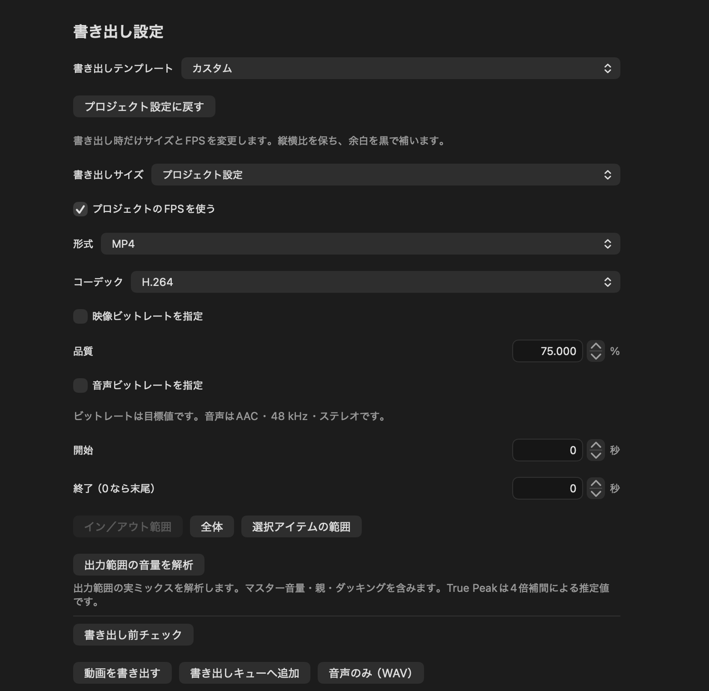

# 書き出しテンプレート

「書き出し設定」→「書き出しテンプレート」で選択します。選択するとMP4、H.264、書き出しサイズ・FPS・映像／音声ビットレートが一括反映されます。開始／終了範囲、プロジェクト自体のサイズ・FPS・編集内容は保持します。「プロジェクト設定に戻す」でサイズ・FPS・ビットレートの上書きを解除できます。

*書き出し設定の例。画像ではテンプレートが「カスタム」になっています。*

1. 編集画面の右上「動画を書き出す」を押し、この設定画面を開きます。
2. 投稿先に合わせる場合は、一番上の「書き出しテンプレート」からYouTube・ニコニコ・X向けの設定を選びます。
3. サイズや形式、書き出す時間範囲を確認します。迷ったら開始・終了を変更せず、全体を書き出せます。
4. 「書き出し前チェック」で警告を確認し、画面下部の「動画を書き出す」を押して保存先とファイル名を指定します。完了まで進捗表示を確認してください。

| 投稿先・サイズ | 30fpsの映像目標 | 60fpsの映像目標 |
| --- | ---: | ---: |
| YouTube 360p | 1 Mbps | 1.5 Mbps |
| YouTube 480p | 2.5 Mbps | 4 Mbps |
| YouTube 720p | 5 Mbps | 7.5 Mbps |
| YouTube 1080p | 8 Mbps | 12 Mbps |
| YouTube 1440p | 16 Mbps | 24 Mbps |
| YouTube 4K | 40 Mbps | 60 Mbps |
| YouTube 8K | 120 Mbps | 180 Mbps |
| ニコニコ 480p | 2 Mbps | — |
| ニコニコ 720p | 6 Mbps | — |
| ニコニコ 1080p | 12 Mbps | 12 Mbps |
| X 1080p | 8 Mbps | — |

YouTubeはSDR向けです。4K・8Kは推奨範囲内の値を採用。ニコニコはユーザー提示の「1080p 12Mbps以上／720p 6Mbps以上／480p以下2Mbps以上」に準拠。Xの8MbpsはVMM側で選んだ実用設定です。ビットレートは固定値や下限保証ではなくエンコーダーの平均目標で、単純な映像や短い動画では実測値が低くなります。SDR Rec.709、H.264 High profile、キーフレーム間隔は最大2秒です。

音声はAAC-LC、48kHz、ステレオ。ニコニコ／Xは192kbps、YouTubeは320kbpsです。YouTube公式のステレオ推奨384kbpsは、このMacのAACエンコーダーで実出力が失敗したため、実出力を確認した320kbpsを採用しました。数値は後から調整可能（音声64〜320kbps）。無音プロジェクトには音声トラックを追加しません。

書き出しは縦横比を保って指定サイズ内へ収め、余白を黒にします。切り抜きや字幕・立ち絵の再配置は行いません。縦動画・正方形はサイズ欄で1080×1920／1080×1080を選べます。設定変更後は「カスタム」と表示します。元動画を高いFPSで書き出しても新しい動きは補間しません。

Xは通常投稿の140秒を超える範囲に案内を表示します。自動で切り詰めません。Premiumや投稿方法で条件が異なるため、投稿先で確認してください。投稿・サービス側の再エンコードを自動実行する機能ではありません。

## MCPからの操作

`vmm_export_template`で適用できます。MCPの `tools/call` では例えば `{"name":"vmm_export_template","arguments":{"template":"niconico720"}}` を指定します。解除は`template:"project"`。IDは`youtube360`／`youtube480`／`youtube720`／`youtube1080`／`youtube1440`／`youtube4K`／`youtube8K`（末尾`High`で60fps）、`niconico`／`niconicoHigh`／`niconico720`／`niconico480`／`x`です。

`vmm_settings_update`でもOptional項目`exportWidth`、`exportHeight`、`exportFPS`、`exportVideoMbps`、`exportAudioKbps`、`exportTemplate`を指定できます。サイズは偶数、最大8192／総画素数7680×4320以下、FPSは1〜60、映像は0.2〜240Mbps。カスタム変更時は`exportTemplate:null`を指定し、プリセット名と実際の設定を一致させてください。旧設定に項目がない場合は従来のプロジェクトサイズ・FPS・品質を使用します。

## 書き出し中の表示

映像の描画・エンコード、音声の準備、映像と音声の合成、保存の段階を表示します。進捗を取得できる合成処理は全体の進捗へ反映します。単一素材の音声処理や最終保存など、細かい進捗を取得できない処理では、段階名を表示したまま処理します。書き出しキューでも現在の段階を確認できます。
