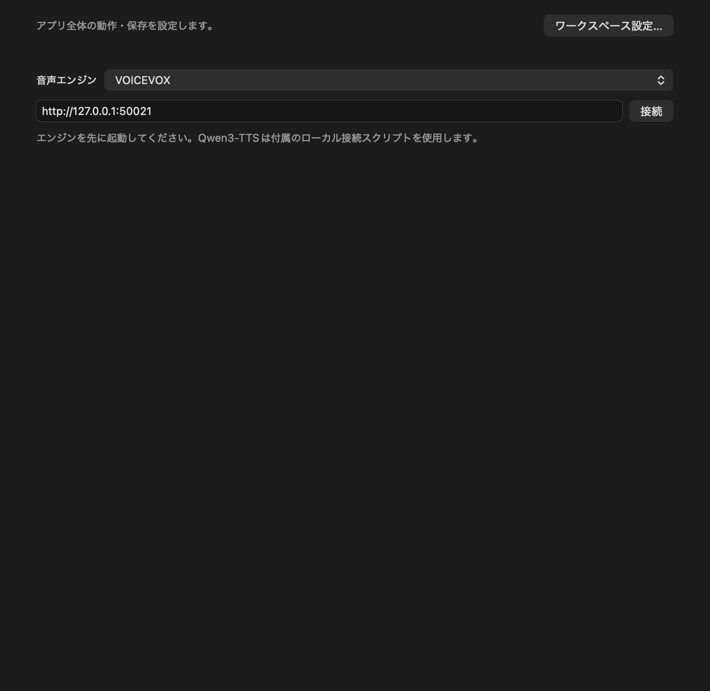

# 音声エンジン / Speech engines

VMMの設定→「音声エンジン」でエンジンと接続先URLを選び、先にエンジンを起動して「接続」を押します。セリフの基本設定にも接続欄があります。話者を選択して音声を生成します。生成した音声は素材ライブラリに表示せず、プロジェクト内に保存し、プレビュー・口パク・書き出しに使用します。

In Settings, choose a speech engine and local endpoint, start the engine, then click Connect. Select a voice in the dialogue inspector and generate speech. Generated audio is stored inside the project and used for preview, lip sync and export, without appearing in the media library.

| Engine | Default endpoint | Supported API / features |
| --- | --- | --- |
| VOICEVOX | `http://127.0.0.1:50021` | `/speakers`, `/audio_query`, `/synthesis`; existing projects retain VOICEVOX behavior |
| AivisSpeech Engine | `http://127.0.0.1:10101` | VOICEVOX compatible routes; style IDs (including negative IDs), engine-specific query fields and speech speed |
| Style-BERT-VITS2 | `http://127.0.0.1:5000` | Official `server_fastapi.py`, `/models/info` and POST `/voice`; model, speaker, style, Japanese/English and speed |
| Qwen3-TTS | `http://127.0.0.1:8001` | Included bridge for the official Python package; CustomVoice models, built-in speakers, Japanese/English/Auto and optional instructions |

接続先はこのMacのループバックURLに限定します。エンジンとモデルのインストール・起動はVMMでは行いません。セリフごとにエンジン・URL・話者・モデル・言語を保持します。接続先の変更だけでは既存のセリフは変更されません。新しい話者を選ぶとそのセリフのエンジンを変更します。キャラ字幕プリセットにも保存できます。生成済み音声の再生・出力にはエンジンの起動は不要です。

Endpoints are restricted to this Mac's loopback addresses. Install and start engines separately. Each dialogue clip retains its own engine, endpoint, voice, model and language. Changing the global connection leaves existing lines unchanged; selecting a voice changes that line. Character subtitle presets also retain speech settings. Saved audio plays and exports without an engine connection.



*設定の「音声エンジン」タブの内容。画像はタブ内の設定部分を示しています。*

### はじめての音声生成（VOICEVOXの例）

1. VOICEVOXを別途インストールして起動します。VMMとは別のアプリです。
2. VMMの上部「設定」→「アプリの設定…」→「音声エンジン」を開き、VOICEVOXと接続先を確認して「接続」を押します。
3. タイムラインでレイヤーと時刻を選び、「セリフ」を押します。追加したセリフを選択し、右側のアイテム設定で本文と話者を選びます。
4. 「音声を生成」を押し、完了したらプレビューの再生ボタンで確認します。「音声を自動生成」を有効にしている場合は、編集内容に応じて自動的に生成されます。

接続できない場合は、エンジンが起動しているか、設定の接続先URLとエンジンの待受先が一致するか確認してください。

## AivisSpeech

[AivisSpeech Engineの公式案内](https://github.com/Aivis-Project/AivisSpeech-Engine)に従ってアプリまたはEngineを起動します。VMMでAivisSpeechを選ぶとポート10101が初期値になります。VOICEVOX互換APIを利用しますが、全クエリ項目がVOICEVOXと同じ意味であるとは仮定せず、エンジンから返されたクエリの独自項目を保持します。VMMが変更するのは話速です。

## Style-BERT-VITS2

[公式リポジトリ](https://github.com/litagin02/Style-Bert-VITS2)でモデルと実行環境を準備し、同リポジトリのルートで次のサーバーを起動します。

```sh
python server_fastapi.py --cpu
```

VMMの接続URLはサーバーの設定したポートに合わせてください。GradioのWeb UIではなく、公式FastAPIサーバーへ接続します。話者欄は「モデル / 話者 / スタイル」の組み合わせです。モデルのフォルダー名と話者・スタイル名で識別し、一覧の順番が変わっても同じ組み合わせを保持します。サーバー側の文字数上限を超えた場合はセリフを分割してください。話速はAPIの`length`の逆数に変換します。

API仕様: [server_fastapi.py](https://github.com/litagin02/Style-Bert-VITS2/blob/master/server_fastapi.py)、[既定のポート設定](https://github.com/litagin02/Style-Bert-VITS2/blob/master/default_config.yml)。

## Qwen3-TTS local bridge

[公式Qwen3-TTS](https://github.com/QwenLM/Qwen3-TTS)のPythonパッケージ`qwen-tts`を別環境へインストールし、**CustomVoice**モデルをローカルディレクトリに準備します。公式案内はPython 3.12の分離環境を推奨しています。VMMはモデルを自動でダウンロードしません。

例（リポジトリのルートで、準備したPython 3.12を使用。モデルはリポジトリの隣の `../models/Qwen3-TTS-12Hz-1.7B-CustomVoice` に配置した場合）:

```sh
python3.12 -m venv .venv-qwen
.venv-qwen/bin/python -m pip install -U qwen-tts soundfile
.venv-qwen/bin/python scripts/qwen3_tts_bridge.py \
  --model ../models/Qwen3-TTS-12Hz-1.7B-CustomVoice \
  --device cpu --port 8001
```

VMMでQwen3-TTSを選択して接続すると組み込み話者を読み込みます。声の指示は任意です。指示による制御は1.7B-CustomVoiceが対象で、0.6B-CustomVoiceには公式の指示制御がありません。話速変更は生成後にVMMの音声処理で行い、ピッチを維持します。

This beta supports **CustomVoice**, not Base voice cloning or VoiceDesign. It uses the included bridge, rather than assuming compatibility with arbitrary third-party Qwen HTTP servers. Optional instruction control is supported by the 1.7B CustomVoice model. VMM adjusts playback speed after synthesis while preserving pitch.

ブリッジはPython標準HTTPサーバーを使い、127.0.0.1だけで待ち受けます。`GET /speakers`は`{"speakers":["name",...]}`、`POST /synthesis`はJSONの`text`, `speaker`, `language`, `instruct`を受けてPCM16 WAVを返します。ブラウザーOriginからのリクエストは受け付けません。推論は直列処理で、同時接続数と受信待ち時間には上限があります。

**このHTTP接続に認証はありません。** 同じMac上の別ユーザーを含むローカルプログラムからも、話者一覧の取得や音声生成を要求できます。これらの制限は負荷を緩和しますが、アクセスの認証にはなりません。共有Macでは、利用時のみ起動し、終了後は停止してください。CPUを初期値とし、`mps`も指定できますが、Mac上のモデル推論・MPS動作・所要時間は未検証です。CPUでは時間とメモリーを多く使う可能性があります。

The bridge listens only on loopback and rejects browser origins, but its HTTP endpoints have **no authentication**. Other local users and programs can request voice lists and synthesis while it is running. Connection limits mitigate resource exhaustion; they do not authenticate clients. On a shared Mac, run the bridge only when needed and stop it afterward.

## 表示言語 / UI language

設定の最上段「表示言語 / UI language」で日本語・Englishを選択できます。メイン編集画面、素材ライブラリ、設定、アニメーション、エフェクト、メニューの表示を切り替え、選択を保存します。字幕、台本、素材名、レイヤー名、フォント名、話者名は翻訳しません。エンジン・OSのエラー、既存の詳細な診断や一部の動的ステータス文は元の言語で表示するβ版です。

Select Japanese or English at the top of Settings. The choice persists and updates editing panels and menus. Project content, media/layer names, font names and voice names are preserved. Engine/OS errors and some detailed diagnostics or dynamic status messages retain their original language in this beta.

## 検証範囲 / Beta verification

VOICEVOXの実サーバーによる音声生成を確認しました。追加3エンジンは公式のAPI形式に基づくモック応答・リクエスト検証です。生成音声の保存、再生、MP4出力、話速処理を確認しています。AivisSpeech、Style-BERT-VITS2、Qwen3-TTSの実エンジン／モデル推論は未確認です。エンジンの完全互換や全機能対応を保証する版ではありません。

VOICEVOX was tested against a live engine. The other three integrations were tested against API-contract fixtures, including voice lists and synthesis requests. Audio storage, playback, speed processing and actual MP4 export were verified. Actual inference with the three added engines is not yet verified.
