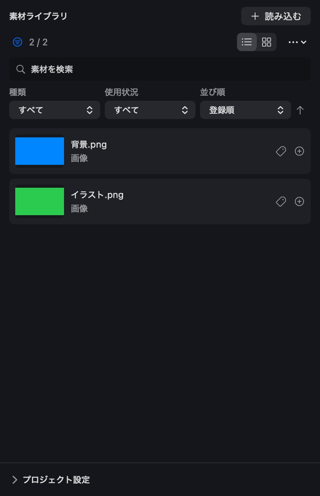

# 制作機能の整理

## 素材ライブラリ

*素材ライブラリの例。画像内の青と緑は説明用の素材です。*

1. 「読み込む」でファイルを選ぶか、Finderからこの領域へドラッグします。
2. 素材の行にある「＋」を押すと、選択したレイヤーの再生位置へ配置されます。素材をライブラリに登録するだけでは、動画には表示されません。
3. 検索欄に素材名やタグを入力し、必要に応じて種類・使用状況・並び順を選びます。不要な条件はクリアボタンで解除します。
4. 再リンクや動画プロキシを使う場合は、右上の「…」→「素材管理…」を開きます。

「検索・絞り込み」で検索欄、種類・並び順・使用状況を表示／非表示にできます。検索語は素材名とタグが対象です。閉じても検索条件は維持されます。種類・使用状況・並び順は同じ行で選べ、パネルが狭いときはその行を横スクロールできます。条件があるときは絞り込みアイコンがオレンジ色になり、隣のクリアボタンで条件をまとめて解除できます。表示状態は次回起動時も保持します。

素材ライブラリとプレビューの境界にある仕切りを左右にドラッグすると、パネル幅を変更できます。素材を右クリックすると、タイムラインへの追加やFinderでの表示、削除などを選べます。「…」→「素材管理…」から再リンクや動画プロキシの作成画面へ移動できます。

プロジェクトや共有素材が開けない場合は、[プロジェクトや共有素材を開けないとき](MEDIA-FORMATS.md#プロジェクトや共有素材を開けないとき)を参照してください。

## 再生が重いとき

1. 「設定」→「ワークスペース設定…」→「プレビューとキャッシュ」で「再生負荷に応じてプレビューを軽量化」がオンになっているか確認します。再生中は負荷に応じて解像度・粒子数・描画FPSを調整します。停止時と書き出しは全品質です。
2. 画質が低く感じる場合は、同じ画面の「プレビューの最低解像度（長辺）」を上げられます。最低解像度を上げると負荷も増えるため、再生の滑らかさと見やすさを見ながら調整してください。
3. 動画素材が重い場合は、素材ライブラリの「…」→「素材管理…」で動画を選び、「プロキシを作成」を押します。プレビューでは軽い動画を使い、書き出しでは元素材を使います。元に戻すには同じ画面の「元素材で編集」を押します。
4. 必要に応じて「タイムライン表示」のサムネイルや音声波形をオフにします。

負荷は画像のサイズや重なり、エフェクト、解像度、Macの性能によって変わります。プロキシ作成と音声の初回準備には時間や一時的な空き容量が必要です。

## セリフ・キャラクター

ツールバーの「セリフ制作」から、台本、キャラ、発音辞書、素材管理、共有ライブラリを開けます。作品ごとのキャラには音声と字幕、立ち絵を設定でき、共有プリセットは別の作品にも利用できます。

## 複数アイテムのまとめ方

- 親子関係: 親の変形に子を連動させます。子はタイムライン上で個別に編集できます。
- グループ: 複数のアイテムをまとめて扱うためのコントロールです。
- プリコンポジション: 複数のアイテムを別の編集画面で編集する、入れ子の合成です。
- シーンライブラリ: アイテムの組み合わせと素材を保存し、別の場所や作品で再利用します。

用途や制約は[詳細な編集](ADVANCED-EDITING.md)、[プリコンポジション](PRECOMPOSITIONS.md)、[制作ワークフロー](PRODUCTION-WORKFLOWS.md)を参照してください。

## 音MAD

プロジェクト設定で音MAD設定の有効／無効を切り替えられます。BPM・拍グリッド、拍合わせや音程パターンはツールバーの「音MAD」で編集します。[音MADモード](AUDIO-MAD-MODE.md)

## 設定

アプリ設定は言語・音声・保存など、ワークスペース設定は画面の見た目・配置、書き出し設定は出力形式などを扱います。メイン画面の「設定」メニューから各設定を開けます。アプリ設定画面からもワークスペース設定と書き出し設定へ移動できます。[設定の分類](SETTINGS-ORGANIZATION.md)

ライト／ダークの切り替えは「ワークスペース設定」→「外観」→「テーマ」で行います。「macOSに合わせる」では、システムの外観に追従します。
